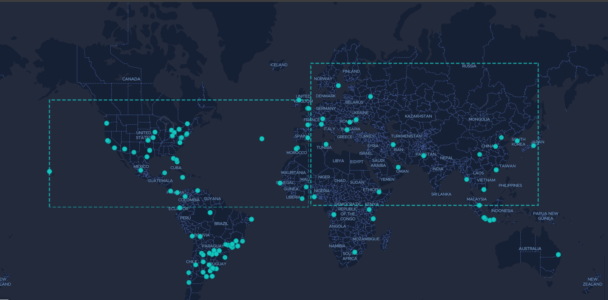

# Cowrie SSH honeypot, hardened and rebuilt

I run a research SSH honeypot on a single small VPS. It went live on 20 November 2026 and the first attacker logged in 26 minutes later.

A default Cowrie install is easy to fingerprint and it quietly loses data: truncated malware uploads, dropped bot commands. To get evidence I could trust I had to make it believable, fix it, and lock it down myself. That is most of what is in this repository: about 8,800 lines of patches against Cowrie 3.1.7, the host hardening around them, and a Filebeat, Elasticsearch and Kibana pipeline for the logs.

## Five days of traffic

20 to 25 November 2026, about 5.3 days:

| | |
|---|---|
| Sessions | 24,822, from 691 unique IPs in 82 countries |
| Password guesses | 23,999, using 1,283 distinct usernames and 4,235 distinct passwords |
| Successful logins | 191, from 83 IPs, a 0.80% hit rate |
| Commands typed | 1,733 |
| Files uploaded | 51, 15 of them unique |

Most guessed passwords: `123456` (1,260), `123` (587), `1234` (489). The username `root` dominated everything.

Credentials that actually worked: `root/admin` (103), `root/123456` (40), `root/changeme` (10).

691 unique source IPs, 82 countries, five days.

## Diicot

The first compromise, 26 minutes in, used `root/changeme`. It was Diicot, a Romanian-linked crypto-mining group. They brute-force SSH, drop a large packed binary that bundles an SSH scanner and spreader with an XMRig-style Monero miner, kill competing miners, and add persistence.

Their first build was 86.8 MB and they uploaded it four times. VirusTotal gave it 1 detection out of 61 when I checked on 20 November. Their 1 MB helper, named `cache`, scored 16 out of 63. I captured three builds in total. One network, AS198364, accounted for 68% of all connections to the honeypot.

## Bugs I found in Cowrie

All four came out of real traffic rather than testing.

**Quadratic stdin buffering.** Uploads over the exec channel (`scp -t`) got slower as they grew, so only 1.7 MB of that first 83 MB Diicot upload was captured. After rewriting the buffering to O(1) appends, a full 83 MB upload takes about 67 s and the SHA-256 matches.

**Exec reply ordering.** Bots built on the paramiko SSH library got `channel closed` and every command they sent was lost, because Cowrie sent its exec replies in the wrong order.

**`&` parsed as a literal argument.** Every `./payload &` and `nohup … &` broke. It is a real background operator now, with `$!`, `wait` and `disown`.

**No pathname globbing or brace expansion.** Both are implemented now, with caps.

## What went wrong

My own AI red team spotted the stock disguise in about a minute. A later run found roughly 22,600 files that claimed a size but had no content, `/etc/os-release` among them, so I rebuilt the whole filesystem from a real Debian 12 install built out of Debian's snapshot archive. Package lists, binaries, `/etc`, symlinks and timestamps are all genuine and internally consistent as a result.

Stock Cowrie gave the game away in smaller ways too. `lspci` listed an NVIDIA GTX 650 and a Wi-Fi card on a cloud server, and `top` printed a Vim error.

Then the new features caused crashes of their own. A symlink loop froze the whole honeypot during testing. Everything I added now has a hard limit:

- glob: 20k visits, 4,096 matches
- brace expansion: 10k words
- awk: 1M steps, 1 MB strings, 2 s alarm
- find: 3 s alarm
- symlink resolution: 40 hops

> **Sanitised publication.** This repository is a scrubbed copy of a live deployment. IP addresses, VPN ranges, usernames, machine IDs and MAC addresses have been replaced with documentation values (`203.0.113.0/24`, `198.51.100.0/24`, `10.99.0.0/24`, `web-staging`, `kim`). The software version strings, process IDs and listening ports left in the patches are plausible stand-ins, not what the live host reports. The persona itself, meaning the fake filesystem, process table and accepted passwords, is deliberately not published, because a public persona would make the honeypot trivial to fingerprint. No logs, captured malware or credentials are included.

## How it is locked down

Public port 22 belongs to Cowrie. The real sshd listens only on WireGuard, so admin access never touches the public interface. Cowrie runs under gVisor as a UID with no host account, with a read-only rootfs, no capabilities and resource limits, and a firewall chain ahead of Docker drops every new outbound connection it tries to make, DNS included. Logs leave over Filebeat into Elasticsearch with GeoIP and ASN enrichment, and Kibana is reachable over the VPN only.

| Layer | What it does | Where |
|---|---|---|
| Emulated shell | `backend = shell`. Nothing an attacker types ever executes. Port forwarding is off. | `cowrie/etc/cowrie.cfg.example` |
| gVisor sandbox | User-space kernel, no host account, read-only rootfs, `cap_drop ALL`, pids/mem/cpu limits. | `docker-compose.yml`, `host/03-host-prep.sh` |
| Egress firewall | Drops every new outbound connection from the honeypot network: internet, DNS and host services. | `host/04-cowrie-firewall.sh` |
| Admin isolation | Real SSH on WireGuard only, key-only. | `host/01-allowlist-vpn.sh`, `host/02-ssh-wireguard-only.sh` |
| Escape canary | auditd alerts if anything runs on the host as the honeypot's UID, and on changes to sudoers, accounts or sshd. | `host/audit/honeypot.rules` |
| Alerting | Discord and ntfy, each alert carrying a playbook: what happened, what it means, what to do. | `host/alerts/` |
| Health checks | 15 checks every 2 minutes, a daily heartbeat so silence means broken alerting, and a disk-cap housekeeper. | `host/alerts/` |
| Containment | One command stops the container, drops inbound traffic, hashes the evidence and notifies. | `host/alerts/honeypot-contain` |
| Verification | 18 outside-in checks, including a throwaway container on the honeypot network trying to reach the internet. | `verify.sh` |

## What the patches add

Beyond the four bug fixes, the patches are mostly about not being obvious:

- `/proc/self` and per-PID `/proc/<pid>/{stat,status,cmdline,environ,…}` consistent with `$$` and `ps`, so a `for p in /proc/[0-9]*` scan tells the same story as everything else
- a real awk interpreter (`hp_awk.py`), step, memory and time limited
- GNU `find`, `xargs`, `timeout`, `sort`, `cut`, `readlink`, procps-accurate `ps`, `top`, `free` and `uptime`, `lspci`, `sysctl`, `ssh` and `ssh-keygen`, `crontab`, `useradd` and family, `dd`
- `ping`, `curl` and `wget` with one consistent "no route out" story, so the firewall and the shell agree
- safe Python, Perl and PHP one-liners, through a hand-written AST evaluator, never `eval`
- PersonaAuth (`auth.py`): only plausible weak passwords work, and each source IP is locked to the first credential that worked for it, so the box stays consistent per attacker

Each patch is bind-mounted over the original Cowrie 3.1.7 module. See `docker-compose.yml`.

## Running your own

The patched Cowrie expects these private files in `cowrie/etc/`, none of which are published: `persona-fs.pickle` (filesystem tree), `persona-ps.json` (process table), `persona-passwords.txt` (accepted credentials), `persona-packages.json` (dpkg list), `userdb.txt`, and `txtcmds/` (canned command outputs). Pick your own story, hardware and dates, and do not reuse anyone else's, because published identifiers make a honeypot trivial to fingerprint.

1. Run `host/01` through `host/05` as root, in order. Each script explains itself and is safe to re-run.
2. `./gen-env.sh`, then set `COWRIE_LISTEN` in `.env`. Start on the VPN address, and switch to the public IP only when you go live.
3. `./up.sh`, then `elk/setup.sh` and `kibana/setup-kibana.sh`.
4. `./verify.sh`. Every check must pass first.

`tests/` holds a twin container that runs with the live limits, a differential harness that sends the same commands to the twin and to real `debian:bookworm`, an abuse suite, and a replay tool for recorded attacker sessions.

## Handling captured malware

Uploads are stored by SHA-256 inside the container's data volume and are never executed or opened on the host. Analysis is hash lookups only. Anything beyond that belongs in an isolated lab VM. No samples are in this repository.

## Licence

BSD-3-Clause throughout, see `LICENSE`.

The files in `cowrie/patches/` are modified Cowrie source. Cowrie is BSD-3-Clause and its copyright headers are kept. Everything else is my own work under the same licence.
